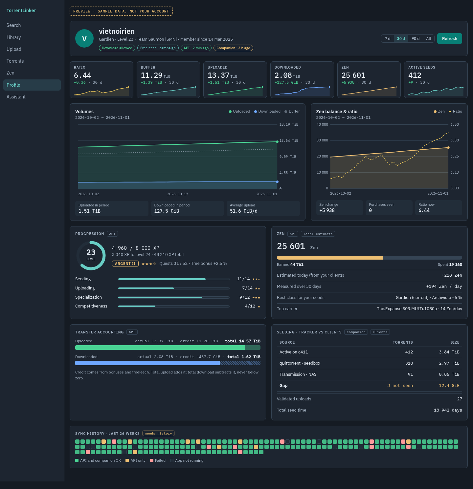
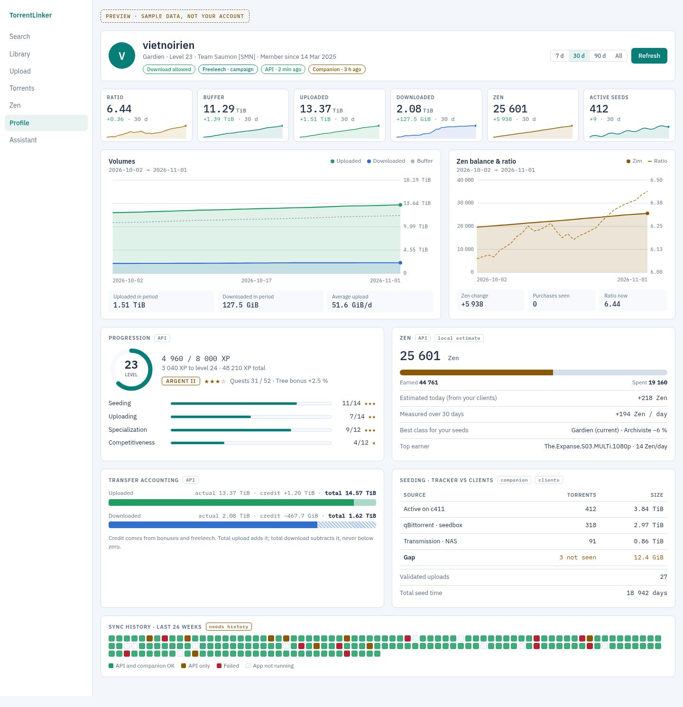
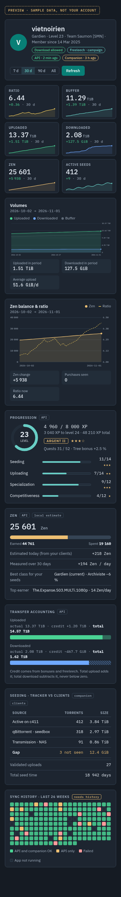

# Profile redesign: account overview with history

Status: planned 2026-11-02. Visual reference: [mockup.html](profile-redesign/mockup.html) (open it in a browser; the period buttons work) and the screenshots below. All numbers in the mockup are sample data.

The Profile workspace shows the c411 API response and the companion's snapshot as text in group boxes. [Tracker Dashboard](https://github.com/Tracker-Dashboard/tracker-dashboard) shows the same kind of account data as stat tiles, evolution charts, a refresh calendar and a tracker-vs-client comparison. This plan brings those ideas to Profile, in our own palette, on desktop and web.

| Desktop, dark | Desktop, light | Phone width (web), dark |
| --- | --- | --- |
|  |  |  |

## What is wrong today

Seen in `ProfileView` (`gui/profile_view.py`) and the Profile tab (`web/static/profile.js`, `index.html`).

- Every value is a sentence in a label: "Earned 31 640 · Spent 19 160", "Quests 31 / 52 · Stars 3". Nothing is visual except one XP bar.
- The API response includes team, grade and freeleech sources, but the parser drops them.
- Only the latest API response and companion snapshot are kept. There is no history, so nothing can show change over time.
- Active seeds on c411 are shown, but never compared with what the user's Torrent Clients actually seed.

## Parity

Desktop and web show the same sections in the same order, with the same labels. The mockup is the reference for both: desktop follows its desktop layout, the web Profile tab follows it at every width down to the phone layout. Use the app's existing theme tokens (`gui/theme.py`, `app.css`); the mockup's colours already match them.

## Sections (top to bottom)

1. **Header**: avatar initial, username, class · level · team · member since, status badges (download allowed or blocked with reason, freeleech and its source, API freshness, companion freshness), period picker, Refresh.
2. **Stat tiles**: ratio, buffer, uploaded, downloaded (actual traffic), Zen Balance, active seeds. Each shows the change over the period and a trend line.
3. **Charts**: Volumes (uploaded, downloaded, dashed buffer) and Zen Balance with ratio. Footer figures under each chart.
4. **Progression**: level ring, XP, grade, stars, quests, tree bonus, one bar per progression path.
5. **Zen**: balance, earned vs spent bar, today's Zen Estimate from the user's clients, Zen measured over the period, best Class for the user's seeds, top earning torrent.
6. **Transfer accounting**: actual and credit per direction as stacked bars, with the c411 rule (upload total adds credit, download total subtracts it, floor zero).
7. **Seeding, tracker vs clients**: active seeds on c411 against seeding torrents per Torrent Client, with the gap; validated uploads and total seed time.
8. **Sync history**: one square per day for 26 weeks (API and companion OK, API only, failed, app not running).

Sections 2's trend lines, 3, 5's measured Zen and 8 need the profile history store.

## Profile history

One row per day per account, kept in the existing SQLite store: the last successful API values of that day (uploaded/downloaded actual and credit, Zen Balance, earned, spent, level, XP), the companion's active seeds and seed time when present, and that day's sync outcome. Changing the indexer or its key starts a new account history, as the profile cache already does. History never changes planning inputs.

## Acceptance

- Desktop and web match the mockup's sections, order, labels and states, in light and dark, and the web tab works at phone width.
- Missing data shows "—" or the section's empty state, never a wrong zero; a null class or team is not an error.
- Period picker (7 d, 30 d, 90 d, All) drives tiles, charts and footer figures together.
- Tests cover history recording, account change, and the period maths.
